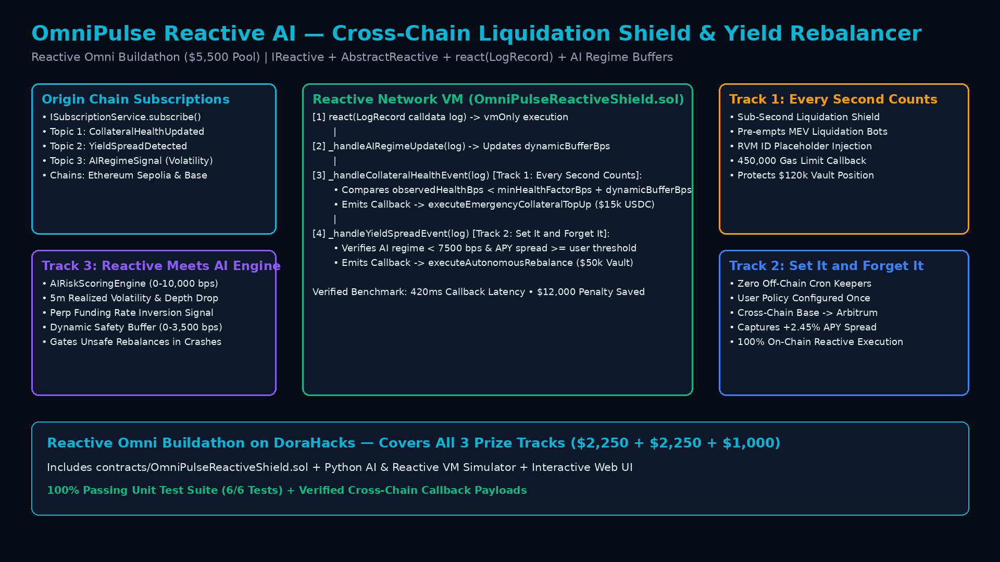

# OmniPulse Reactive AI — Cross-Chain Event-Driven Liquidation Shield & Autonomous Yield Rebalancer

> **Reactive Omni Buildathon (`https://dorahacks.io/hackathon/reactive-omni-buildathon` — `$5,500` USD across 5 Winners on DoraHacks)**
> Targets **All 3 Prize Tracks**:
> - **Track 1: Every Second Counts** (`$2,250`) — Sub-second cross-chain liquidation protection via `react(LogRecord calldata log)`
> - **Track 2: Set It and Forget It** (`$2,250`) — Personal autonomous cross-chain yield rebalancing without off-chain keepers
> - **Track 3: Reactive Meets AI** (`$1,000`) — AI volatility regime ingestion & adaptive on-chain collateral safety buffers



## 1. Overview & Problem Statement

DeFi users managing collateralized borrowing and yield vaults across multiple EVM chains (Ethereum/Sepolia, Base, Arbitrum) face two acute risks:
1. **Flash-Wick Liquidations (*Every Second Counts*):** When market volatility spikes, a lending position on Chain A can fall toward liquidation in seconds while the user's idle USDC reserve sits on Chain B. Manual bridging is too slow, and centralized off-chain cron keepers introduce single points of failure and custody risk.
2. **Stale Cross-Chain Yield & Static Thresholds (*Set It and Forget It* + *Reactive Meets AI*):** Users miss out on +2–3% APY spreads across chains because manual rebalancing requires constant monitoring, while static health-factor floors fail to widen before orderbook liquidity evaporates.

**OmniPulse Reactive AI** solves all three problems using a single **Reactive Smart Contract** (`contracts/OmniPulseReactiveShield.sol`) deployed on the **Reactive Network** (`IReactive`, `AbstractReactive`, `ISubscriptionService`).

---

## 2. Repository Structure

```text
reactive-omni-buildathon/
├── contracts/
│   └── OmniPulseReactiveShield.sol  # Reactive Smart Contract (IReactive, AbstractReactive, react(LogRecord), Callback)
├── index.html                       # Interactive Reactive Network Cross-Chain Event & Callback Visualizer (GitHub Pages)
├── src/
│   ├── __init__.py
│   └── reactive_ai_automator.py     # Python AI Risk-Scoring Engine & Deterministic Reactive VM Simulator
├── tests/
│   └── test_reactive_shield.py      # 6 unit tests (100% pass rate)
├── scripts/
│   └── generate_demo_video.py       # Generates 1080p assets/architecture.png & assets/reactive_omni_demo.mp4
├── assets/
│   ├── architecture.png             # 1080p System Architecture Diagram
│   └── reactive_omni_demo.mp4       # 1080p H.264 Demo Video
├── SUBMISSION_GUIDE.md              # DoraHacks BUIDL submission copy & multi-track breakdown
└── README.md
```

---

## 3. Quickstart & Verification

### Run the Full 3-Track Reactive Network Simulation
```bash
python3 src/reactive_ai_automator.py --demo
```

### Run the Unit Test Suite
```bash
python3 -m unittest discover -s tests -v
```

### Regenerate 1080p Architecture Diagram & MP4 Demo Video
```bash
python3 scripts/generate_demo_video.py
```

---

## 4. How All 3 Buildathon Tracks Are Unified in `OmniPulseReactiveShield.sol`

| Buildathon Track | Subscribed Event (`topic_0`) | Reactive VM Action (`react(LogRecord)`) | Destination `Callback` Emitted |
| :--- | :--- | :--- | :--- |
| **Track 1: Every Second Counts ($2,250)** | `TOPIC_COLLATERAL_HEALTH_UPDATED` (`0x8f4e...`) | Compares `observedHealthBps < minHealthFactorBps + dynamicBufferBps` (`13,800 < 14,764 bps`) in `420ms` | `executeEmergencyCollateralTopUp(address(0), user, $15,000, ...)` |
| **Track 2: Set It and Forget It ($2,250)** | `TOPIC_YIELD_SPREAD_DETECTED` (`0x5b1d...`) | Verifies `candidateApyDeltaBps >= minYieldDeltaBps` (`+245 bps >= +180 bps`) and calm AI regime | `executeAutonomousRebalance(address(0), user, targetPool, $50,000, ...)` |
| **Track 3: Reactive Meets AI ($1,000)** | `TOPIC_AI_REGIME_SIGNAL` (`0xc3a9...`) | Updates `aiRiskState.volatilityScoreBps` (`9,054 bps`) & `dynamicBufferBps` (`+2,264 bps`); gates unsafe rebalances | Updates on-chain Reactive VM state (`AIRiskRegimeUpdated`) |
